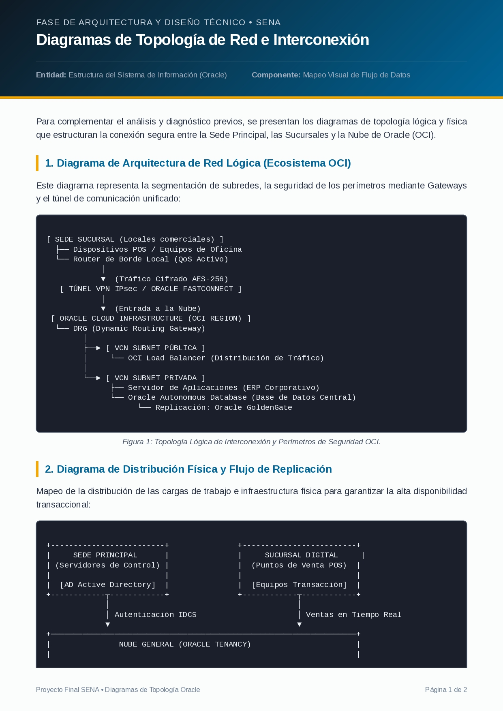

# Plan de Infraestructura de Red - SENATIC

## Diagrama de la topología de red

## Diseño de la infraestructura

## Cableado estructurado

## Seguridad informática

## Simulación en Cisco Packet Tracer

